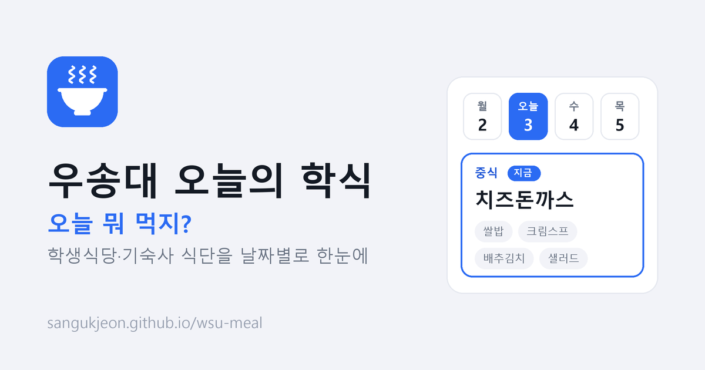
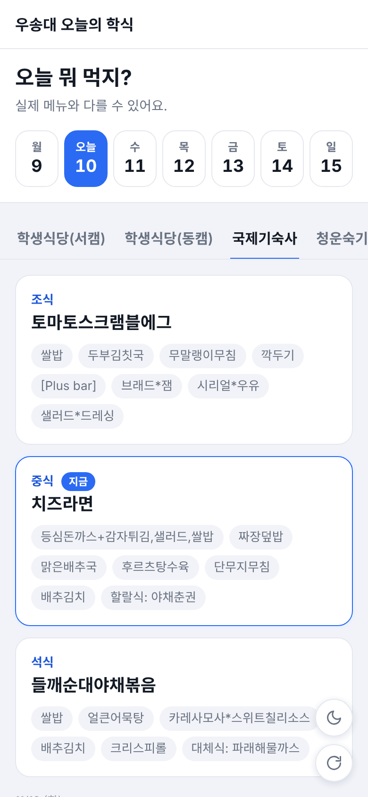
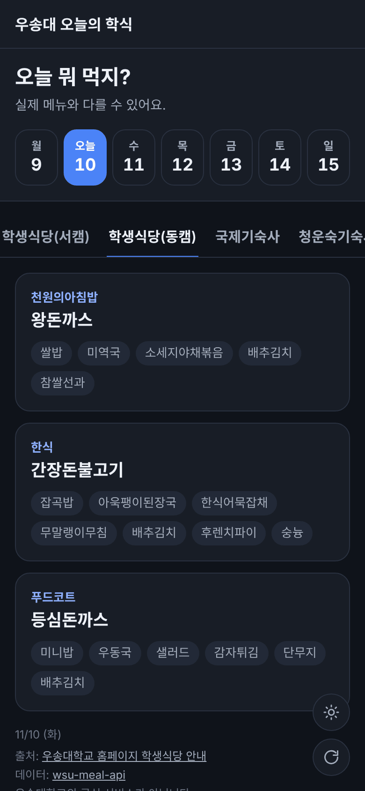
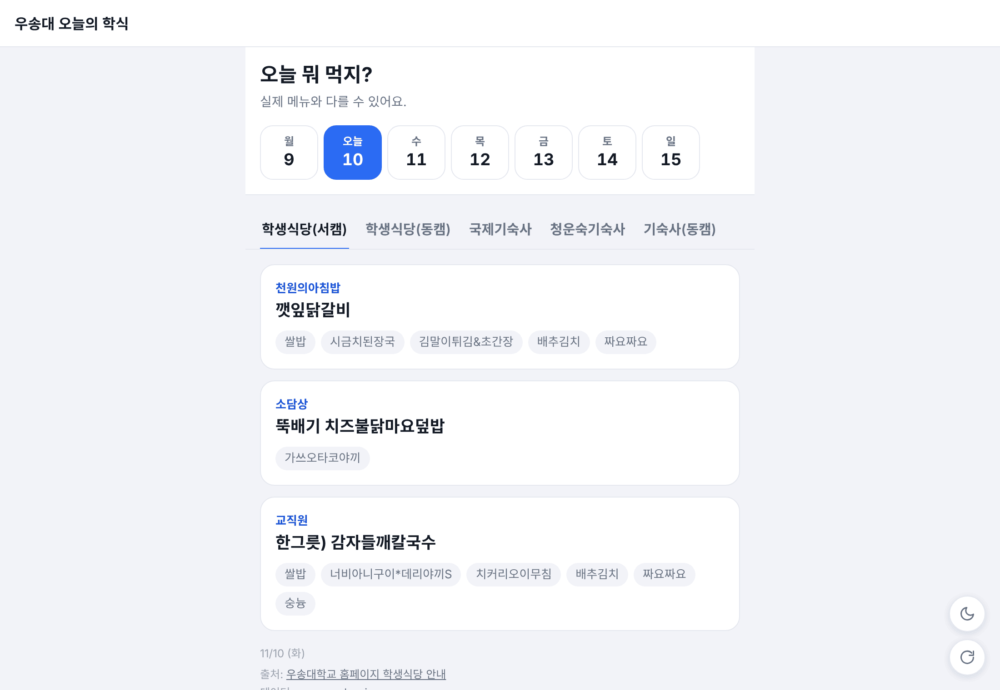
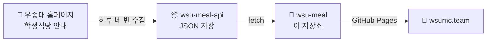

<div align="center">


# 우송대 오늘의 학식

**오늘 뭐 먹지?** 학생식당·기숙사 식단을 날짜별로 한눈에

[](https://www.wsumc.team/)

[](https://www.wsumc.team/)




</div>

<br />

## 📸 화면

<table>
  <tr>
    <td align="center"></td>
    <td align="center"></td>
  </tr>
  <tr>
    <td align="center"><sub>☀️ 밝은 모드 · 지금 끼니에 <b>지금</b> 표시</sub></td>
    <td align="center"><sub>🌙 다크 모드</sub></td>
  </tr>
</table>

<details>
<summary><b>🖥️ PC 화면 보기</b></summary>
<br />

</details>

## ✨ 기능

| | 기능 | 설명 |
|:-:|---|---|
| 📅 | **날짜 고르기** | 이번 주 날짜를 요일·날짜로 골라 봐요. 오늘이 기본이에요. |
| 🏫 | **식당 탭** | 학교 홈페이지와 같은 순서예요. 마지막으로 본 식당을 기억해요. |
| 🍛 | **한눈에 보는 메뉴** | 주메뉴는 크게, 나머지 반찬은 작은 알약으로 보여 줘요. |
| ⏰ | **"지금" 표시** | 오늘 기숙사 식당은 지금 시간에 맞는 끼니(조식·중식·석식)에 표시가 붙어요. |
| 🌙 | **다크 모드** | 폰 설정과 상관없이 켜고 끌 수 있고, 고른 테마를 기억해요. |
| 🔄 | **새로고침** | 오른쪽 아래 버튼으로 페이지를 새로 불러와요. |

## 🔧 동작 방식



- **데이터:** [wsu-meal-api](https://github.com/sangukjeon/wsu-meal-api)가 학교 홈페이지 식단을 하루 네 번 JSON으로 저장해요.
- **화면:** 빌드 없이 HTML·CSS·자바스크립트 파일만으로 동작해요.

## 📁 구성

```
wsu-meal/
├── index.html   # 페이지 뼈대, 링크 미리보기(OG) 설정
├── style.css    # 밝은/다크 테마 스타일
├── app.js       # 식단 불러오기, 날짜·식당 탭, 테마
├── icon.svg     # 파비콘·홈 화면 아이콘
├── og.png       # 링크 미리보기 이미지 (1200×630)
└── CNAME        # www.wsumc.team
```

## 💻 로컬에서 보기

```bash
python -m http.server 4321
```

브라우저에서 `http://localhost:4321`을 열어요.

## 🚀 배포

**Settings → Pages**에서 `Deploy from a branch`, 브랜치 `main`, 폴더 `/ (root)`를 골라요.

---

<div align="center">
<sub>
우송대학교의 공식 서비스가 아닙니다.<br />
식단 출처는 <a href="https://www.wsu.ac.kr/page/index.jsp?code=campus0806">우송대학교 홈페이지 학생식당 안내</a>이며, 실제 제공 메뉴와 다를 수 있습니다.
</sub>
</div>
